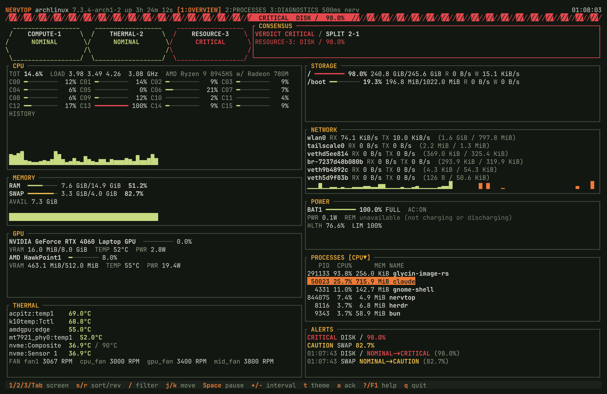
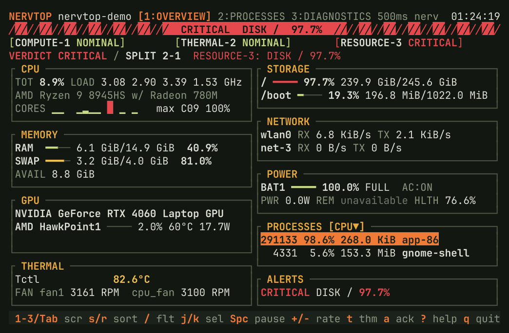
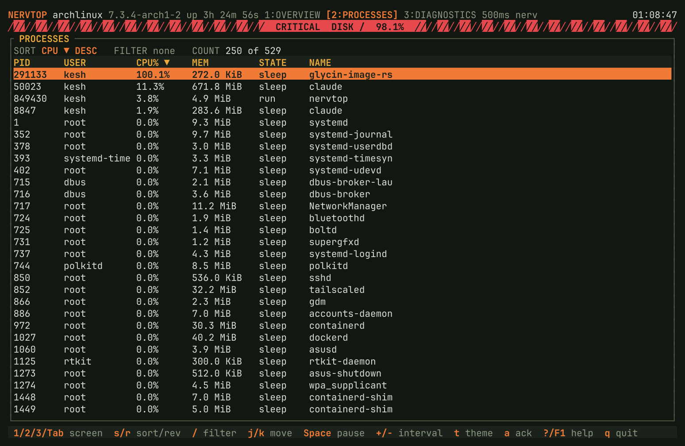
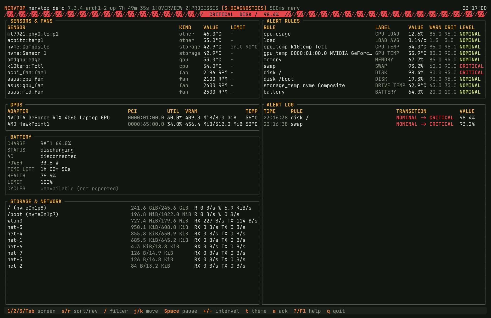
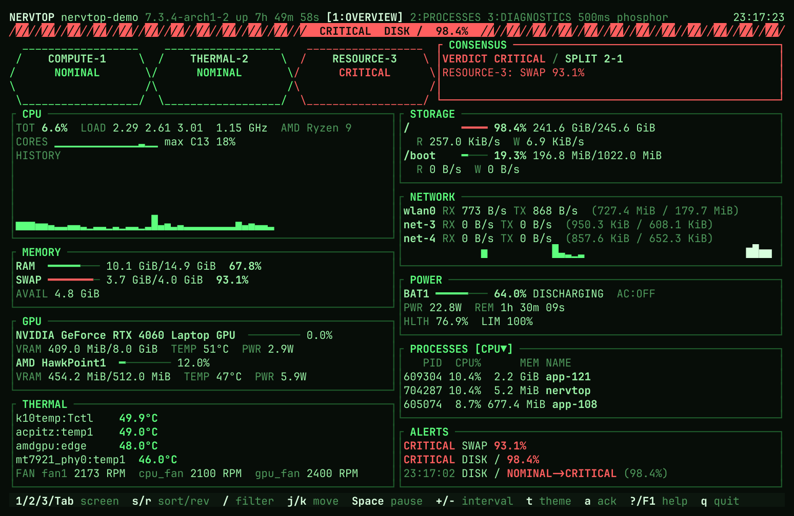

# nervtop

A command-center system monitor for the Linux terminal.
Per-core CPU, memory, GPUs, temperatures and fans, storage, network, battery and processes on one screen, judged by three independent status cells that vote NOMINAL, CAUTION or CRITICAL.

[](https://github.com/bananatruck/nervtop/actions/workflows/ci.yml)
[](https://github.com/bananatruck/nervtop/releases/latest)
[](LICENSE)



The screenshot is the real program with live data from an ASUS laptop, rendered by `scripts/screenshots.sh`; the root filesystem really was 98 percent full, which is why the banner is up.
The screenshots use `--redact`, so the hostname, user names, non-generic process names and non-standard network interface names are replaced with neutral labels (`nervtop-demo`, `user`, `app-07`, `net-2`); every number is real.

nervtop is the terminal companion to [NERV Fieldnotes](https://github.com/bananatruck/nerv-fieldnotes) and shares its palette: a charcoal green ground, amber headings, orange accents and pale green for healthy values.
The look borrows the language of an anime control room (hexagonal status cells, warning-stripe banners, a three-way vote) as original work.
It ships no logos, artwork, fonts, audio or dialogue from any show.

## Install

Download the static Linux x86_64 binary from the latest release and run it:

```sh
mkdir -p ~/.local/bin && curl -sL https://github.com/bananatruck/nervtop/releases/download/v0.1.3/nervtop-v0.1.3-x86_64-unknown-linux-musl.tar.gz | tar xz -C ~/.local/bin --strip-components=1 nervtop-v0.1.3-x86_64-unknown-linux-musl/nervtop
~/.local/bin/nervtop
```

If `~/.local/bin` is on your `PATH` (most desktop distributions add it), plain `nervtop` works from then on.
The binary is statically linked, so it runs on any x86_64 Linux distribution.
Each release also carries a `.sha256` file for the archive.

### From source

Rust 1.95 or newer is required.

```sh
cargo install --locked --git https://github.com/bananatruck/nervtop --tag v0.1.3
```

### Arch Linux

`packaging/arch/PKGBUILD` builds the tagged release from source:

```sh
cd packaging/arch && makepkg -si
```

It is not published to the AUR.

## Requirements

Linux with `/proc` and `/sys`, and a terminal of at least 80 columns by 24 rows.
nervtop runs as a normal user and never asks for root.
NVIDIA readings need `nvidia-smi` (from `nvidia-utils`); AMD readings come straight from sysfs.
GPU model names come from the `hwdata` PCI database when it is installed.
A terminal with 24-bit colour shows the default theme as designed; the `ansi` theme works in any terminal.

## Screens

| Key | Screen | What it shows |
| --- | --- | --- |
| `1` | OVERVIEW | Header, consensus strip, alert banner, and the CPU, MEMORY, GPU, THERMAL, STORAGE, NETWORK, POWER, PROCESSES and ALERTS panels |
| `2` | PROCESSES | A full process table you can sort, filter and scroll |
| `3` | DIAGNOSTICS | Sensors and fans, GPU fields, the full battery record, disks and interfaces, the alert rule table and the alert log, as many rows as the terminal fits (`nervtop --once` lists everything) |

The layout adapts to the terminal.
At 80x24 it keeps every panel and shows all cores as a one-line strip; larger terminals add history sparklines and more rows.
Below 80x24 nervtop shows the current size and the minimum, and keeps sampling so data is ready when the window grows.







## Keys

| Key | Action |
| --- | --- |
| `q`, `Ctrl+C` | Quit |
| `?`, `F1` | Help overlay with every key |
| `1`, `2`, `3` | Overview, processes, diagnostics |
| `Tab`, `Shift+Tab` | Next, previous screen |
| `Space` | Pause or resume sampling (the screen keeps the last sample) |
| `+`, `-` | Sample interval up or down: 250 ms, 500 ms, 1 s, 2 s, 5 s, 10 s |
| `t` | Cycle themes for this session |
| `s` | Cycle the process sort: CPU, memory, PID, name |
| `r` | Reverse the sort |
| `/` | Filter processes by name; `Enter` keeps the filter, `Esc` clears it |
| `j`, `k`, arrows | Move the process selection or scroll diagnostics |
| `PgUp`, `PgDn`, `g`, `G` | Page up, page down, top, bottom of processes or diagnostics |
| `a` | Acknowledge alerts: the banner drops its warning stripes and keeps only its label until a rule rises to a higher level |

While the help overlay is open, the next key only closes it.

## The consensus strip

Three cells each judge one part of the machine and vote.

| Cell | Judges |
| --- | --- |
| COMPUTE-1 | Total CPU usage and the one-minute load average per core |
| THERMAL-2 | The hottest CPU sensor, the hottest GPU, and drive temperatures |
| RESOURCE-3 | Memory, swap, every mounted filesystem, and the battery while discharging |

A cell votes the worst level among its rules, or NO DATA when none of its inputs can be read.
The verdict is the worst vote, and the strip says whether the vote was unanimous or split (`SPLIT 2-1`, `SPLIT 1-1-1`).
When the verdict is CRITICAL, a warning-stripe banner names the worst alert.
GPU utilisation is shown but not judged, so a busy GPU in a game is not an alarm.

## Alerts

Every rule has a CAUTION (`warn`) and a CRITICAL (`crit`) threshold.

| Rule | Measures | warn | crit | hysteresis |
| --- | --- | --- | --- | --- |
| `cpu_usage` | Total CPU, percent | 85 | 95 | 2 |
| `load` | One-minute load average per logical core | 1.5 | 3.0 | 0.1 |
| `cpu_temp` | Hottest CPU sensor, °C | 85 | 95 | 3 |
| `gpu_temp` | Hottest GPU, °C | 80 | 90 | 3 |
| `memory` | RAM in use (total minus available), percent | 85 | 95 | 2 |
| `swap` | Swap in use, percent (skipped without swap) | 60 | 90 | 2 |
| `disk` | Space used per mounted filesystem, percent | 90 | 95 | 1 |
| `storage_temp` | NVMe and drive temperatures, °C | 65 | 75 | 3 |
| `battery` | Charge while discharging, percent (fires at or below) | 20 | 10 | 2 |

A level rises only after the condition holds for `sustain` consecutive samples (3 by default), so a one-second spike does not light the screen.
A level falls as soon as the value moves back past the threshold by the rule's hysteresis margin, so a value hovering on the line does not flicker.
A rule whose source cannot be read shows NO DATA; it never counts as healthy.

## Configuration

nervtop reads `$XDG_CONFIG_HOME/nervtop/config.toml` (normally `~/.config/nervtop/config.toml`), or the file given with `--config`.
Every key is optional, and a missing file means the defaults.
Print the complete default file, with a comment on every key, and start from it:

```sh
mkdir -p ~/.config/nervtop
nervtop --print-config > ~/.config/nervtop/config.toml
```

A shortened example:

```toml
[general]
interval_ms = 1000          # 250 to 10000
hide_kernel_threads = true

[theme]
name = "nerv"               # nerv, phosphor or ansi

[theme.colors]
background = "reset"        # keep your terminal's transparency and blur
accent = "#ef7b36"

[alerts]
sustain = 3

[alerts.cpu_temp]
warn = 80.0
crit = 92.0

[alerts.swap]
enabled = false
```

A rule table only needs the keys you change; the others keep that rule's defaults.
Unknown keys, misspelled keys and invalid values are errors that name the key, printed before the terminal is touched, with exit code 2.
A test proves that the output of `--print-config` parses to exactly the built-in defaults, so the documentation cannot drift from the code.

### Themes

| Theme | Look |
| --- | --- |
| `nerv` | 24-bit colour: charcoal green, amber, orange and pale green, matching NERV Fieldnotes |
| `phosphor` | A green phosphor CRT look, with yellow-green for caution and red kept for alerts |
| `ansi` | Only the 16 terminal colours, so it follows a pywal, base16 or any other terminal scheme |

Any colour slot can be overridden with `#rrggbb`, an ANSI colour name or `reset`.
The slots are `background`, `surface`, `border`, `text`, `muted`, `accent`, `heading`, `nominal`, `caution`, `alert`, `unknown` and `stripe_dark`.
Overrides apply to the theme named in the config file; `--theme` with a different theme and the `t` key show the other themes unmodified.



## Command line

```text
Usage: nervtop [OPTIONS]

  --config PATH       Read a config file
  --interval MS       Sample every 250 to 10000 ms
  --theme NAME        nerv, phosphor, ansi
  --print-config      Print the complete documented default config
  --once              Print a live report and exit
  --json              JSON report, requires --once
  --screenshot PATH   Render live UI to SVG
  --size WxH          Screenshot size, 80x24 to 500x200 (default 120x40)
  --screen NAME       overview, processes, diagnostics (screenshot only)
  --samples N         Samples taken before the screenshot, 1 to 600 (default 4)
  --redact            With --once or --screenshot: mask host, user, process and interface names
  -h, --help          Print help
  -V, --version       Print version

Use --print-config to see all configuration keys and defaults.
```

`nervtop --once` prints a plain text report of every reading (the 15 busiest processes rather than the full list), every rule and the consensus, which is handy over SSH or in a script.
`nervtop --once --json` prints the full snapshot, every rule and the consensus as JSON for other tools and agents.
Its fields come in three kinds:

- Readings are `{"status": "available", "value": ...}` or `{"status": "unavailable", "value": "<reason>"}`: every panel under `snapshot` (`cpu`, `memory`, `disks`, `network`, `processes`, `sensors`, `gpus`, `battery`), the `host` fields, and fields measured on their own, which are the load average, disk and network rates and totals, the GPU figures, battery power, time remaining and health, and a process's `cpu_percent`; for example `"load_avg": {"status": "available", "value": [5.0, 2.64, 1.92]}`.
- Optional fields, which a machine may simply not report, are the bare value or `null`, never a reading: `freq_mhz` and `brand` of the CPU, `crit_celsius` of a temperature, and `ac_online`, `charge_limit_percent` and `cycle_count` of the battery; for example `"crit_celsius": 89.85` or `"cycle_count": null`.
- Everything else is a plain value, for example `"memory_bytes": 10170368`.

Add `--redact` to `--once` or `--screenshot` before sharing the output: it masks the hostname, user names other than system service accounts, process names outside a short list of generic programs, network interface names other than `lo`, `ethN`, `wlanN` and bus-position names such as `enp3s0`, in which every systemd naming marker carries its number (MAC-based names such as `enx001122aabbcc`, and look-alikes such as `ens1finn`, are masked), and every mount point outside a standard set (`/`, `/boot`, `/home`, `/var` and similar), which become `/mnt/disk-1`, `/mnt/disk-2` and so on; every number is unchanged.
It keeps hardware and driver names, which identify a machine model rather than a person: the kernel release, CPU and GPU models, sensor chip and label names, block device names and the battery name, as well as kernel thread names.
Control characters in any collected name are always replaced with `?`, with or without `--redact`, so a process name cannot inject terminal escape sequences into a report.
A one-shot report has no history, so its alert levels are instantaneous (sustain 1).

## Where the numbers come from

Every number on screen is read from the running machine.
When something cannot be read, nervtop shows `unavailable` and the reason, never a zero or a guess.

| Data | Source |
| --- | --- |
| CPU usage | `/proc/stat` counter deltas |
| Load, CPU model, processes, users | [`sysinfo`](https://crates.io/crates/sysinfo); process names from `/proc/<pid>/stat` when its start time matches, so a process that called `exec` shows its new name |
| CPU frequency | `scaling_cur_freq` per online CPU, else that CPU's `cpu MHz` or `clock` in `/proc/cpuinfo` |
| Memory and swap | `/proc/meminfo`, with current-read failure detection |
| Disk space | `/proc/self/mountinfo` filtered to visible block-device mounts (by mount and parent IDs), then `statvfs(3)`, one entry per device; network and FUSE mounts, and local mounts hidden under them, are never queried, so a hung server cannot freeze nervtop |
| Disk read and write rates | `/proc/diskstats` |
| Network rates and totals | `/sys/class/net` interface indices and byte counters; raw names stay distinct, loopback and never-used interfaces hidden |
| Temperatures and fans | `/sys/class/hwmon` |
| AMD GPU | `gpu_busy_percent`, `mem_info_vram_*` and hwmon files of the PCI device |
| NVIDIA GPU | `nvidia-smi --query-gpu`, at most once every 2 seconds, with a 2 second timeout |
| Battery | `/sys/class/power_supply`, in either energy or charge units |

Rates and CPU usage need two samples, so nervtop takes a warm-up sample 250 ms before the first frame with data.

nervtop never wakes a sleeping discrete GPU.
On hybrid laptops the NVIDIA GPU powers down when unused; nervtop reads its runtime power state from sysfs first, and while it is suspended the GPU panel shows SUSPENDED and nvidia-smi is not run.
Polling nvidia-smi on a schedule would keep the GPU awake and cost battery.

## Resource use

Historical measurements for v0.1.1 and v0.1.2, taken with `scripts/measure-idle.sh` on the machine nervtop was built for: an ASUS laptop with an AMD Ryzen 9 8945HS (16 logical cores), an RTX 4060 laptop GPU and about 560 to 580 processes running, with a release build left untouched in a 160x48 tmux terminal for 60 seconds.
The cost depends heavily on how fast the CPU is clocked, so the table names the power profile.

| Build | Power profile | Interval | Average CPU | Resident memory |
| --- | --- | --- | --- | --- |
| v0.1.1 | not recorded, on battery | 1000 ms (default) | 2.43% of one core | 6.2 MiB |
| v0.1.1 | not recorded, on battery | 2000 ms | 1.20% of one core | 6.1 MiB |
| v0.1.2 | power-saver, on battery | 1000 ms (default) | 5.63% of one core | 6.2 MiB |
| v0.1.2 | power-saver, on battery | 2000 ms | 2.92% of one core | 6.2 MiB |

In the historical comparison, during the same minute in power-saver mode, the v0.1.1 binary measured 5.67% and v0.1.2 measured 5.63% of one core at 1000 ms.
On a 16-thread machine, even the power-saver figure is about 0.35% of the whole CPU.
In the profiling documented for v0.1.0, most of the cost was reading `/proc` for every process (about 16 ms per sample) and the hwmon sensors (about 10 ms, mostly the Wi-Fi chip and the ASUS embedded controller's fan readings); drawing a 160x48 frame took under half a millisecond.
These measurements have not been repeated for v0.1.3.
Your figure depends on the number of processes and on how slow your sensors are to read; run the script to measure it on your machine.

## How it works

```text
collector thread ──┐
input thread ──────┼──> one channel ──> main thread: apply, draw
signal thread ─────┘
```

| Module | Role |
| --- | --- |
| `collect` | Every metric source implements one shared `Source` trait (host info uses `HostSource`); real sources read sysinfo, `/proc` and `/sys`, fakes serve tests |
| `alert` | Rules with sustain and hysteresis, and the three-cell consensus |
| `app` | All UI state and key handling, with no terminal code |
| `ui` | Draws an `&App` into a frame and keeps no state of its own |
| `runtime` | The event loop: a collector thread, an input thread and a signal thread feed one channel |
| `report` | `--once` text and JSON |
| `svg`, `screenshot` | Render the real UI into ratatui's test backend and write it as SVG |

The main thread blocks on the channel and redraws only when a sample, a key or a resize arrives, so nothing spins between samples.
The terminal is restored on every exit path: normal quit, errors, a panic (through ratatui's panic hook), and SIGTERM, SIGHUP or SIGINT.

The full behaviour is specified in [docs/SPEC.md](docs/SPEC.md).

## Development

```sh
cargo test --locked
cargo clippy --all-targets --locked -- -D warnings
cargo fmt --check
```

The suite has 326 passing tests (and 2 ignored ones that need the live machine or a real terminal: run them with `cargo test -- --ignored`).
Parsers are tested against captured sysfs and procfs text, including the battery values of a real ASUS laptop, and every sysfs reader takes a root directory so tests run on temporary trees.
Render tests draw the real UI into ratatui's `TestBackend` at 80x24, 120x40 and 200x60 and assert on the drawn buffer.
Integration tests run the built binary.
CI runs all three commands on every push to main and on every pull request, and the release workflow runs them again before it builds and smoke-tests the static binary.

### Screenshots

Every image in this README is the real program showing live data from the machine it ran on.

```sh
cargo build --release --locked
scripts/screenshots.sh
```

The script runs `nervtop --screenshot`, which samples the machine, draws the real UI into ratatui's test backend, and writes that buffer as SVG; `rsvg-convert` turns it into PNG.
Block characters are drawn as rectangles, the way terminal emulators draw them.

### Measuring idle CPU

```sh
cargo build --release --locked
scripts/measure-idle.sh target/release/nervtop 60
```

## Status

Version 0.1.3 is complete for its scope: every panel, screen, key, config option and alert rule described here works and is tested.

Changes since v0.1.2:

- CPU usage reads fresh counters and requires a valid baseline old enough for a rate; failed reads restart warm-up, and load-average availability is independent.
- CPU frequency is read per logical CPU ID from `scaling_cur_freq`, else from that CPU's `cpu MHz` or `clock` line; BogoMIPS is never shown as a frequency, and a CPU with no frequency source shows none.
- Memory and swap read fresh values each sample and report read or parse failures as unavailable.
- Network rates follow interface identity across renames and replacements, reject unreadable counters, and keep availability separate for each direction's totals and rates.
  Interface names retain their raw identity and are escaped for display.
- An interface whose counters start at zero gets rates from its next sample, and an interface that changed between reads keeps its row with its readings unavailable instead of disappearing or adding a partial total.
- After a pause, network rates start again from fresh baselines instead of counting the paused interval.
- Process owners refresh periodically, failed scans restart warm-up, and the selected process survives an unavailable scan.
  Navigation reuses one sorted process list per action.
- A process that calls `exec` shows the name of its new program.
- A process's CPU usage shows `--` ("warming up") until it has been measured: on its first scan, and after a scan in which it had used no CPU time if it has used some since; such processes sort after measured ones, and a process idle across two scans shows a measured 0.
- GPU queries bound output reads and preserve device identity across cache hits.
- Each NVIDIA GPU's device ID is checked again after the `nvidia-smi` query, so a card that changed meanwhile gets no row, and a timed-out query still counts toward the two-second limit while it is cleaned up.
- A GPU whose power status cannot be read is reported as "power state unknown", and other GPUs keep their own state and reason.
- Disk alerts track kernel devices rather than mount labels.
- Disks are read from `/proc/self/mountinfo`, and only mounts that path lookup actually reaches are queried, so a local mount hidden under a network mount (for example under NFS on `/data`) is never asked for space; this also holds in a chroot or container.
- A mount point that is not valid UTF-8 is shown with those bytes escaped as `\xNN`, and a device whose first mount point cannot be queried falls back to another one.
- The AC adapter reads as unknown, not offline, when a power supply cannot be classified; battery percentage, time remaining and health each use one complete energy or charge pair.
- A hwmon directory that exists but cannot be listed reads "hwmon sensors not readable"; vt1211 channels that are not in degrees Celsius are left out.
- Diagnostics tables scroll with the navigation keys and clamp to the rows that fit after resizing or inventory changes.
- Page keys in diagnostics move by the number of rows the tables show, and the position is kept while the terminal is too small to draw them.
- Storage and network rows show each available read or write direction when the other is unavailable, shortening an unavailable one to `-` on narrow terminals; alert rule values are never clipped.
- The header, footer, consensus strip and thermal panel fit their text by terminal cells, so a wide hostname, a narrow terminal or a long sensor label no longer clips the clock, the verdict or the temperature.
- `--redact` now also masks interface names that only look predictable: a kept name must be systemd's naming markers each followed by its number (`ens33`, `enp0s31f6`), so a name such as `ens1finn` is masked.
- Screenshot files are created readable and writable by their owner only.
- In `--once --json` output, a process's `cpu_percent` is now a reading object, like the other readings, instead of a bare number: `{"status": "available", "value": 0.0}`, or `{"status": "unavailable", "value": "warming up"}`.
  Scripts that read `snapshot.processes.value[].cpu_percent` as a number need updating.

Known limits:

- Linux only, because it reads `/proc` and `/sys` directly.
- Intel GPUs are listed by name but their utilisation, memory, temperature and power are shown as unavailable; there is no unprivileged sysfs interface for them that nervtop reads yet.
- One battery is shown; a second battery is ignored.
- nervtop observes and never acts: it has no kill, signal or renice keys, by design.

nervtop was built by AI coding agents directed by Kesh and reviewed by independent automated reviewers.

## License

MIT, see [LICENSE](LICENSE).
